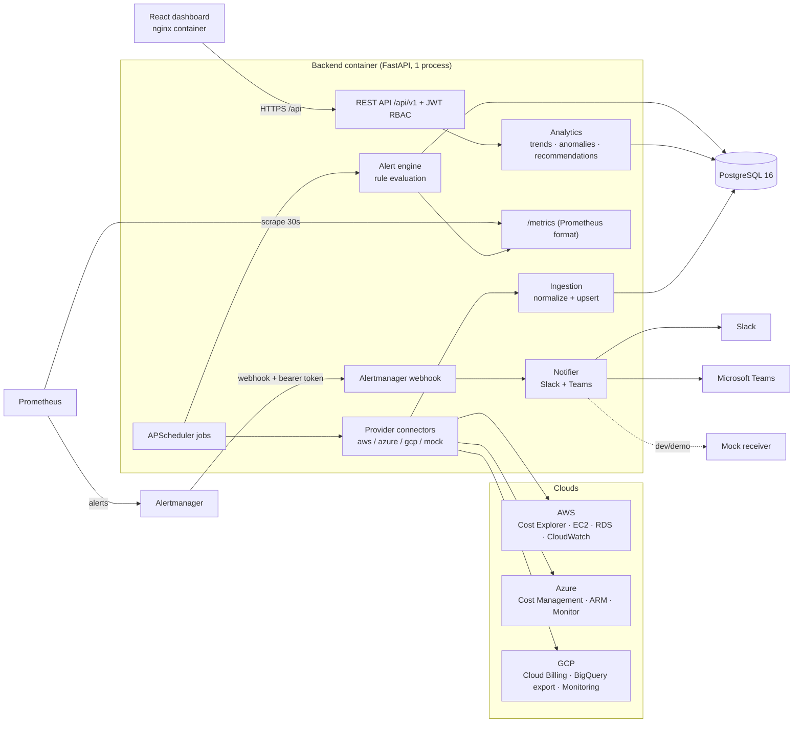
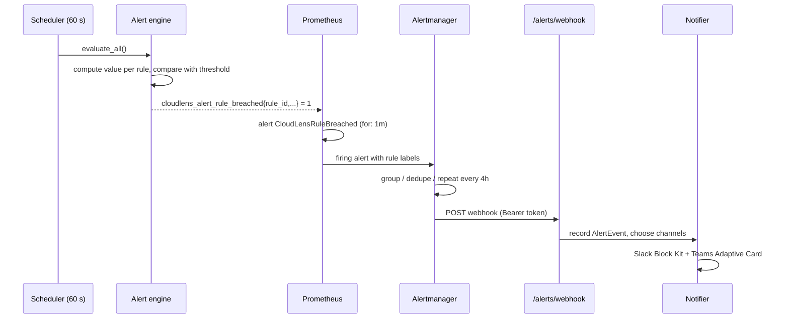

# Architecture

## 1. Context

DevOps teams that run on several clouds see costs in three separate consoles, each with its own
vocabulary ("SERVICE" in AWS, "ServiceName" in Azure, "service.description" in GCP) and its own
billing delay. CloudLens pulls all three into one normalized store, analyses it, and alerts on it.

## 2. Component diagram

## 3. Containers (docker-compose)

| Service | Image | Purpose | Exposed |
|---|---|---|---|
| `db` | postgres:16-alpine | Historical cost, inventory, metrics, rules, events | internal |
| `backend` | built from `backend/` | API, scheduler, connectors, alert engine | 127.0.0.1:8000 |
| `frontend` | built from `frontend/` (nginx) | React SPA + reverse proxy for `/api` | `HTTP_PORT` (8080 / 80) |
| `prometheus` | prom/prometheus:v2.55.1 | Scrapes `/metrics`, evaluates alert rules | 127.0.0.1:9090 |
| `alertmanager` | prom/alertmanager:v0.27.0 | Groups, de-duplicates and routes alerts | 127.0.0.1:9093 |
| `mock-receiver` | built from `monitoring/mock-receiver` | Fake Slack/Teams webhook for dev/demo | 127.0.0.1:9000, `/mock-inbox/` |

Only the dashboard port is public. Prometheus, Alertmanager and the API are bound to localhost and
reached through nginx or an SSH tunnel.

## 4. Data flow

### 4.1 Cost and resource collection (Sprints 1–2)

1. **Scheduler** (`services/scheduler.py`) triggers jobs: backfill on first start, a daily sync at
   02:00 IST, an intraday refresh of today's cost every 15 min, and utilization every 5 min.
2. **Provider factory** (`services/providers/__init__.py`) returns `MockProvider` or the live
   connector, depending on `DATA_SOURCE`.
3. **Connectors** return unified dataclasses: `CostItem`, `ResourceItem`, `MetricItem`.
4. **Normalizer** maps native service names to `compute | containers | database | storage | networking | other`.
   It maps tag values (`prod`, `stg`, `dev`...) to `production | staging | development | unassigned`,
   and converts INR billing to USD.
5. **Ingestion** upserts with `INSERT … ON CONFLICT DO UPDATE` on natural keys, so every job is
   idempotent. Each run is logged in `sync_runs`, including the number of API calls made.

### 4.2 Dashboard (Sprints 3–4)

The React app calls `/api/v1/dashboard/overview`, a single request that returns KPIs, trend,
breakdowns, utilization, top resources and recent alerts, every 60 seconds. Other screens call the
focused endpoints (`/costs/*`, `/resources/*`, `/reports/*`). All aggregation is done in SQL `GROUP BY`
queries with indexes on `(provider, usage_date)`, `(environment, usage_date)` and `(resource_type, usage_date)`.

### 4.3 Alerting (Sprint 5)

Because rules live in PostgreSQL and are exported as one gauge per rule, users can create and change
alert criteria in the UI without editing Prometheus files. Prometheus still does the alert lifecycle,
and Alertmanager handles grouping, repeat intervals, inhibition and resolved notifications.

`ALERT_DELIVERY=direct` bypasses Prometheus. The engine notifies on state changes itself, which is
useful when running without Docker.

## 5. Technology choices

| Decision | Choice | Reason |
|---|---|---|
| Database | **PostgreSQL** (not MongoDB) | Cost data is tabular and relational (provider × account × day × service × env). SQL `GROUP BY`, unique constraints for idempotent upserts and composite indexes fit trend analysis directly. |
| API | **FastAPI** | Async-capable, Pydantic validation, auto-generated OpenAPI docs at `/docs`. |
| Scheduler | **APScheduler in-process** | No extra broker; enough for a few jobs. Run 1 worker so jobs aren't duplicated. |
| Frontend | **Custom React + Recharts** | Full control over filters, drill-down, theme and currency; Grafana can't offer RBAC-aware editing of alert rules. |
| Alerting | **Prometheus + Alertmanager** | Industry standard; grouping, dedupe, silences and inhibition come for free. |
| Notifications | **Incoming webhooks** | No bot tokens needed; Slack Block Kit and Teams Adaptive Cards. |
| Auth | **JWT + bcrypt** | Stateless; role in the token; checked by FastAPI dependencies on every route. |
| Packaging | **Docker Compose** | One command for 6 services; same stack locally and on EC2. |

## 6. Security

- Passwords are hashed with bcrypt (12 rounds). JWTs are signed HS256 with an 8-hour expiry.
- Every API route requires a token. Write operations require the `admin` role (`require_admin`).
- The Alertmanager webhook is protected by a shared bearer token, compared in constant time.
- Secrets live only in `.env` and `secrets/`, both git-ignored. The AWS instance role is preferred over keys.
- Containers run as non-root users. Only the dashboard port is exposed. nginx adds security headers.
- Cloud credentials need **read-only** permissions (see `deploy/aws/iam-policy.json` and the setup guide).

## 7. Scalability notes

- Data volume: about 30 cost rows per provider per day, roughly 33k rows/year for three providers. Metrics are
  hourly or 5-minute per resource with a 90-day retention. PostgreSQL handles this easily on a t3.small.
- For hundreds of accounts: move the scheduler into a separate worker container (Celery or RQ) and
  partition `cost_records` by month. See [future-enhancements.md](future-enhancements.md).
