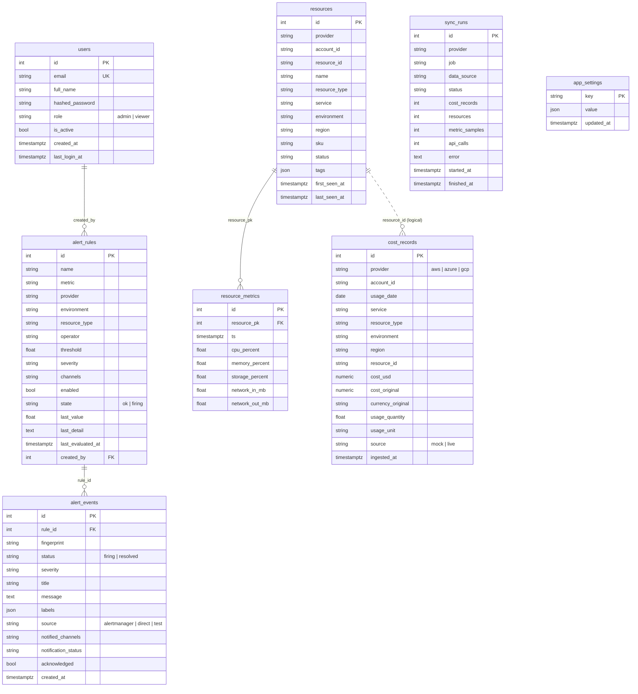

# Database Design (PostgreSQL 16)

Tables are created by SQLAlchemy on startup (`init_db()` → `Base.metadata.create_all`).
Models live in `backend/app/models/`.

## Entity-relationship diagram



## Unified cost schema (the heart of the system)

Every provider's billing data is converted into `cost_records` with **one grain**:

> provider + account + day + service + environment + region + resource

| Field | AWS source | Azure source | GCP source |
|---|---|---|---|
| `usage_date` | `TimePeriod.Start` | `UsageDate` (yyyymmdd) | `DATE(usage_start_time)` |
| `service` | `SERVICE` dimension | `ServiceName` | `service.description` |
| `environment` | tag group `environment$<v>` | `TagValue` of the env tag | label `environment` |
| `region` | `global` (CE groups by 2 keys max) | `ResourceLocation` | `location.region` |
| `cost_usd` | `UnblendedCost.Amount` | `Cost` (INR → USD) | `cost + credits` (export conversion rate) |

`resource_type` is derived from `service` by `services/normalizer.py`.

## Constraints and indexes

| Table | Constraint / index | Purpose |
|---|---|---|
| cost_records | `UNIQUE(provider, account_id, usage_date, service, environment, region, resource_id)` | Idempotent upserts: re-running a sync never duplicates |
| cost_records | `(provider, usage_date)`, `(environment, usage_date)`, `(resource_type, usage_date)`, `(usage_date)` | Fast filtered `GROUP BY` for trends |
| resources | `UNIQUE(provider, resource_id)` | Inventory upsert |
| resource_metrics | `UNIQUE(resource_pk, ts)`, index `(resource_pk, ts)` | Latest-sample and window queries |
| users | `UNIQUE(email)` | Login |

## Retention (cost optimization)

The daily `retention` job (03:30) deletes:

- `resource_metrics` older than `METRICS_RETENTION_DAYS` (90)
- `cost_records` older than `COST_RETENTION_DAYS` (730)
- `sync_runs` older than 60 days

With 3 providers, about 25 resources and hourly or 5-minute samples, the database stays well under 500 MB.

## Volume estimate (mock data)

| Table | Rows after 180-day backfill |
|---|---|
| cost_records | about 6,000 (≈ 33 / day) |
| resources | 25 |
| resource_metrics | about 3,400 initial, +about 550 / hour at 5-minute sampling |

## Backup and restore

```bash
./scripts/backup_db.sh                        # backups/cloudlens_<timestamp>.sql.gz (keeps 14)
./scripts/backup_db.sh restore backups/file.sql.gz
```

## Useful queries

```sql
-- Monthly cost per provider
SELECT date_trunc('month', usage_date) AS month, provider, round(sum(cost_usd), 2)
FROM cost_records GROUP BY 1, 2 ORDER BY 1, 2;

-- Top 10 services in the last 30 days
SELECT service, round(sum(cost_usd), 2) AS cost FROM cost_records
WHERE usage_date >= current_date - 30 GROUP BY service ORDER BY cost DESC LIMIT 10;

-- Latest CPU per resource
SELECT DISTINCT ON (r.name) r.name, m.ts, m.cpu_percent
FROM resource_metrics m JOIN resources r ON r.id = m.resource_pk
ORDER BY r.name, m.ts DESC;
```
