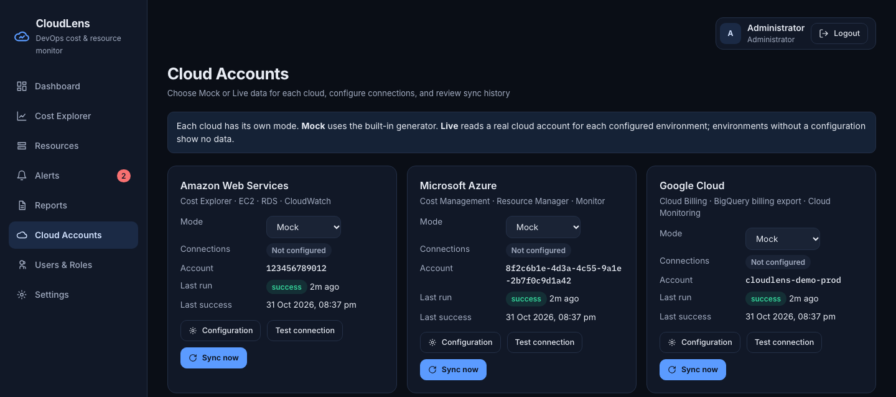
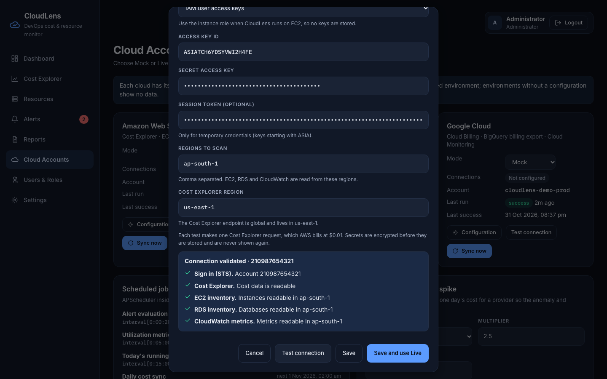

# Connecting Real Cloud Accounts (Mock and Live Modes)

This guide explains how to show real AWS, Azure or GCP cost data in CloudLens, what it costs, and what to
expect. An Admin does everything on screen. `.env` holds no Live settings.



> **About these screenshots.** The AWS ones were taken against a simulated AWS service with made-up credentials and
> figures. The Azure failure screenshot is a real response from Microsoft to a made-up tenant.

## 1. How it works

Every cloud starts on **Mock**. Each cloud has one **Mode** dropdown:

| Mode | Where the data comes from | Needs credentials |
|---|---|---|
| **Mock** | Built-in generator, covering every environment | No |
| **Live** | One real cloud account per configured environment | Yes, validated first |

The **Environment** you choose in a configuration links that account to the Environment filter on Dashboard, Cost Explorer,
Resources and Reports. All of the account's cost and resources appear under that environment.

| Example: AWS on Live, Azure on Mock | What the Environment filter shows |
|---|---|
| Production: AWS account A configured | AWS account A's real data, plus Azure's mock Production data |
| Staging: AWS account B configured | AWS account B's real data, plus Azure's mock Staging data |
| Development: no AWS configuration | **No AWS data**, with a message saying so, plus Azure's mock Development data |
| All environments | Accounts A and B, plus all of Azure's mock data |

Keep these points in mind:

- **Each environment needs its own account.** CloudLens refuses to save an account already used by another environment of
  that cloud, because its cost would count twice. An account here means an AWS account, Azure subscription or GCP project.
- **Tags no longer decide a Live cost's environment.** The account does. Mock data keeps its built-in environments.
- **A cloud has one mode.** A Live cloud shows no mock data at all, including in environments you haven't configured.
- **Mixed totals add real and simulated money.** When some clouds are Live and others Mock, data screens warn:
  *Totals combine real and simulated cost*.
- **Switching modes loses nothing.** Mock and Live data are stored separately. Switching back shows the earlier data and
  fetches only the days missed.
- **Budgets and alert rules are shared by both modes.** Lower the $120,000 budget and the "AWS daily spend above $1,800" rule
  in **Settings** and **Alerts** to suit the real account.

## 2. Set up an environment

1. Complete the [prerequisites for that cloud](#3-prerequisites-for-each-cloud).
2. Sign in as an Admin and open **Cloud Accounts**.
3. Click **Configuration** on the cloud's card, or choose **Live** in its Mode dropdown (the same form opens).
4. Choose the **Environment** and fill in the fields, then click **Test connection**.
   
5. Read the result. Each permission is checked separately, so one test lists everything to fix.
   
6. Click **Save and use Live**, or **Save** if the cloud is already Live. **Save** stays off until the values on screen have
   passed the test, and changing any value turns it off again.
7. Repeat for each other environment that has its own account. The form marks those already done as *(configured)*.
8. The first load runs in the background. Watch **Sync history** at the bottom of the page. Figures appear when the load
   finishes, usually within a few minutes.


To return to simulated data, set the dropdown to **Mock**; your saved connections are kept. To delete an environment's connection,
choose it in the form and click **Remove**. Its figures stop showing. Removing the last one returns the cloud to Mock.


## 3. Prerequisites for each cloud

### AWS

Do these in the AWS Console for **each account**:

| Step | Where | Notes |
|---|---|---|
| Enable Cost Explorer | Billing and Cost Management → Cost Explorer | The first activation can take up to 24 hours |
| Allow CloudLens to read data | IAM → Policies → Create policy, paste [`deploy/aws/iam-policy.json`](../deploy/aws/iam-policy.json) | Read-only: cost, EC2, RDS, CloudWatch, identity |
| Create the identity | IAM → Users → Create user, attach the policy, then Security credentials → Create access key | If CloudLens runs on EC2, attach the policy to the instance role instead and choose *EC2 instance role*, so no keys are stored |

**A management account shows only its own cost**, not its member accounts'. Configure member accounts as their own environments.

**Form fields:** Authentication, Access key ID, Secret access key, Session token (only for temporary keys that start with `ASIA`),
Regions to scan (every region where your EC2 and RDS resources run), Cost Explorer region (leave as `us-east-1`).

### Azure

For **each subscription**:

```bash
az ad sp create-for-rbac --name cloudlens-reader --role "Cost Management Reader" --scopes /subscriptions/<SUBSCRIPTION_ID>
az role assignment create --assignee <appId> --role "Monitoring Reader" --scope /subscriptions/<SUBSCRIPTION_ID>
az role assignment create --assignee <appId> --role "Reader" --scope /subscriptions/<SUBSCRIPTION_ID>
```

**Form fields:** Tenant ID (`tenant`), Client ID (`appId`), Client secret (`password`), Subscription ID.

### GCP

GCP does not offer daily cost lines through its billing API, so CloudLens reads the BigQuery billing export.

1. Billing → Billing export → **Standard usage cost** → enable it to a BigQuery dataset. Data starts from the day
   you enable it (Google backfills only part of the current and previous month), so history starts short.
2. Enable the BigQuery, Cloud Monitoring and Cloud Billing APIs on each project.
3. Create a service account with **BigQuery Data Viewer**, **BigQuery Job User** and **Monitoring Viewer** on the project,
   plus **Billing Account Viewer** on the billing account, then create a JSON key.

One export can cover many projects; each connection reads only rows for its own project.

**Form fields:** Service account key (paste it or choose the file), Project ID, Billing export table
(`project.dataset.gcp_billing_export_v1_XXXXXX`).

## 4. What it costs

Estimates assume the default schedule and 10 AWS resources per connection. **AWS charges apply per connection.** Confirm current
prices on the [AWS Cost Explorer](https://aws.amazon.com/aws-cost-management/aws-cost-explorer/pricing/) and
[CloudWatch](https://aws.amazon.com/cloudwatch/pricing/) pricing pages.

| Item | Rate | Typical use | Per month |
|---|---|---|---|
| AWS Cost Explorer | $0.01 per request | 1 daily sync + 4 refreshes of today's cost = about 5 requests a day | about **$1.50** |
| AWS CloudWatch `GetMetricData` | $0.01 per 1,000 metrics | 10 resources every 5 minutes = about 86,400 metrics | about **$0.86** |
| AWS first load, each **Test connection** | $0.01 per request | Once, and whenever you click | a few cents |
| AWS EC2, RDS and STS read calls | Free | | $0 |
| Azure Cost Management, Resource Manager, Monitor reads | No per-request charge within normal use | | about $0 |
| GCP BigQuery queries | On-demand scan pricing, with a free monthly allowance | Limited to 2 GB per sync | usually about $0 |
| GCP Cloud Monitoring reads | No charge for reading metrics | | $0 |

**Built-in safeguards:** today's cost refreshes at most every 6 hours per Live connection (at 15 minutes it would cost about $29 a month
on AWS). The daily sync re-reads only the last 3 days. The **API calls** column in Sync history shows what each run used.

## 5. Where the data differs from Mock

These are limits of what the billing APIs return, not faults in your setup:

| On Live | Why | What you can do |
|---|---|---|
| **Potential savings shows $0**, and resources show $0 cost | Billing is read per service, not per resource, and savings are calculated from each resource's cost | See [suggested improvements](#8-suggested-improvements). Idle and over-utilized status still work from CPU |
| AWS cost region shows `global` | The cost query groups by service only | Use the Resources screen for region |
| AWS inventory covers only EC2 and RDS | Those are the two connected inventories; other services still appear in cost | S3, Lambda and EKS are on the roadmap |
| Memory is blank for AWS | CloudWatch reports EC2 memory only with the CloudWatch agent installed | CPU-based views still work |
| Today's cost lags | Providers publish costs with a delay of up to about 24 hours | Normal behavior |
| Deleted resources stay listed | Inventory adds and updates resources but does not remove them yet | See [suggested improvements](#8-suggested-improvements) |

## 6. Security

- **Encrypted at rest.** Cloud secrets and webhook URLs are encrypted (Fernet: AES with HMAC) before they reach the database,
  using a key derived from `JWT_SECRET`.
- **Set a strong `JWT_SECRET`.** The sample value is public, so set your own (`openssl rand -hex 32`) before saving real
  credentials. Changing it later signs everyone out and means entering saved secrets again; the screens tell you when this has happened.
- **Never sent back.** The API only reports whether a secret is set. Secrets are also removed from error messages.
- **Admin only.** Viewers can see each cloud's mode but cannot open, test or change a configuration.
- **Use read-only credentials.** The policy and roles above cannot change or create anything in your cloud.
- **Use HTTPS outside your own machine.** The bundled stack serves plain HTTP. On a shared server, put HTTPS in front before
  entering credentials, or they travel unencrypted.

## 7. If something goes wrong

| What you see | What to do |
|---|---|
| *Account … is already configured for …* | Use a different account for this environment, or remove the other environment's connection first |
| *AWS rejected these credentials* | Check the access key, secret key and session token. Temporary keys expire |
| *Cost Explorer is not enabled or has no data yet* | Enable it in the Billing console and test again later (up to 24 hours) |
| *This identity lacks the permission* | Attach `deploy/aws/iam-policy.json`. Admin rights are not needed |
| *Azure rejected this service principal* | Check the tenant ID, client ID and client secret. Secrets expire |
| *The service account lacks a role* or *This API is not enabled* | Add the roles or enable the APIs listed in [GCP](#gcp) |
| *AWS: no Development configuration, so no data here* | Expected for a Live cloud. Configure that environment or choose another |
| Dashboard label says *sync failing, showing last data* | Credentials stopped working. The card and **Sync history** show which environment; test and save it again |
| *The saved secret cannot be decrypted* | `JWT_SECRET` changed. Enter the secret again |

More is in [troubleshooting.md](troubleshooting.md).

## 8. Suggested improvements

Not built yet, in the order I would add them:

| Improvement | Why it matters |
|---|---|
| Resource-level AWS cost (Cost Explorer resource-level data or Cost and Usage Report) | Brings back per-resource cost and savings recommendations on Live. Has an extra AWS charge |
| Mark deleted resources (use `last_seen_at`) | Stops terminated instances counting in the inventory |
| Separate budgets for Live | Real accounts need different budgets from the demo; today both modes share one |
| AWS cross-account role (AssumeRole) | Avoids long-lived keys |
| Alembic migrations and an audit log of configuration changes | Safer upgrades, and a record of who changed credentials or modes |

## 9. What changed in the code

For developers. Full details are in [modules/providers.md](modules/providers.md) and [api-reference.md](api-reference.md).

| Area | Change |
|---|---|
| `.env` | All cloud settings, `DATA_SOURCE`, `ENV_TAG_KEY`, `INSTALL_CLOUD_SDKS` and the webhook URLs are gone. The `secrets/` folder is gone |
| Database | `cloud_accounts` holds each cloud's mode. New `cloud_connections` (one row per cloud and environment, with encrypted secrets). New `resources.source` and `sync_runs.environment`. Existing databases are upgraded at startup |
| Connectors | Built from a connection's settings. Everything they return is labelled with that connection's environment, and only that account's cost is read |
| Sync | One run per connection, so one bad credential doesn't stop the others |
| Analytics | Live rows show only if their cloud is Live and they belong to the account saved for that environment |
| API | `/cloud-accounts/{provider}` endpoints take an `environment` |
| Webhooks | Slack and Teams URLs are saved in Settings. The backend writes the Slack URL to a shared volume, which Alertmanager reads each time it sends |
| Frontend | Mode dropdown and Configuration button per cloud, Environment section in the form, shared filter bar on Reports, mode labels from the API |
