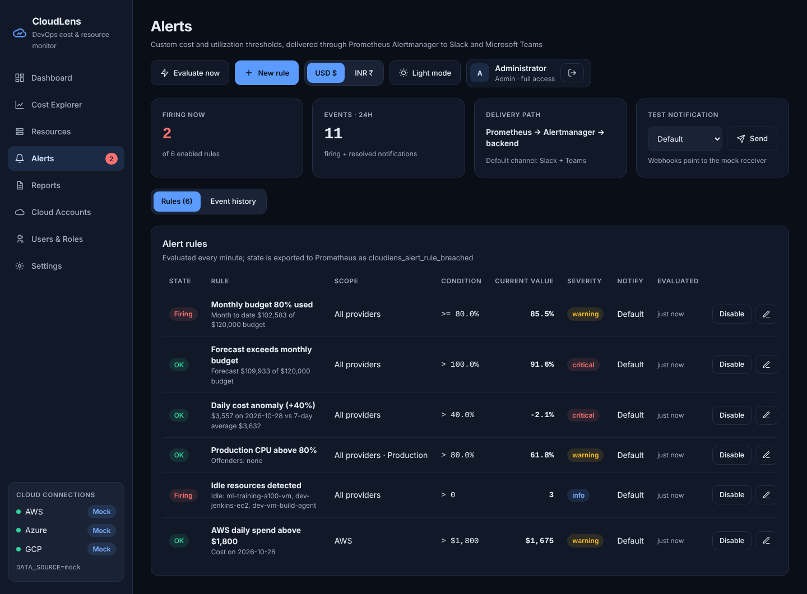

# Screen: Alerts

**Route:** `/alerts` · **File:** `frontend/src/pages/AlertsPage.jsx`
**APIs:** `/alerts/rules`, `/alerts/events`, `/alerts/metrics`, `/alerts/evaluate`, `/alerts/test`, rule CRUD, `/alerts/events/{id}/ack`

## Purpose
Sprint 5: let users define their own alert criteria and see what has been sent.

## Sections

| Section | Details |
|---|---|
| Header actions (admin) | **Evaluate now**, **New rule** |
| KPIs | Firing now (of enabled rules), events in the last 24 h, delivery path (Alertmanager or direct) + default channel, **Test notification** (admin: channel select + Send) |
| Rules tab | State (Firing / OK / Disabled), name + live detail (offenders, computed amounts), scope, condition, current value, severity, channel, last evaluated; admin actions: Enable/Disable, Edit, Delete (confirm) |
| Event history tab | Time, status (firing/resolved), severity, title + message, source (alertmanager/direct/test), channels, delivery status (+ error), **Ack** button; severity filter |

## Rule form (modal)
Name · Watch (metric catalog from the API) · Condition (`> >= < <=`) · Threshold (unit shown) · Provider ·
Environment · Resource type · Severity · Notify (Default / Slack / Teams / Both) · Description · Enabled.
Saving validates on the server (422 errors are shown in the form) and evaluates immediately, so the new rule's
state shows at once.

## Role differences
Viewers see rules and history and can acknowledge events, but cannot create, edit, delete, test or evaluate.

## Extension notes
See [../modules/alert-engine.md](../modules/alert-engine.md#adding-a-metric-type) to add metric types; the form picks them up automatically.
