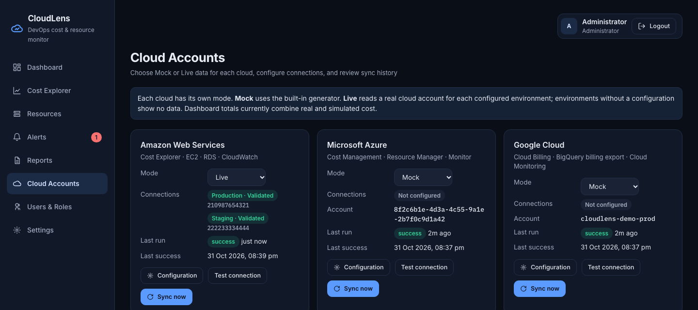
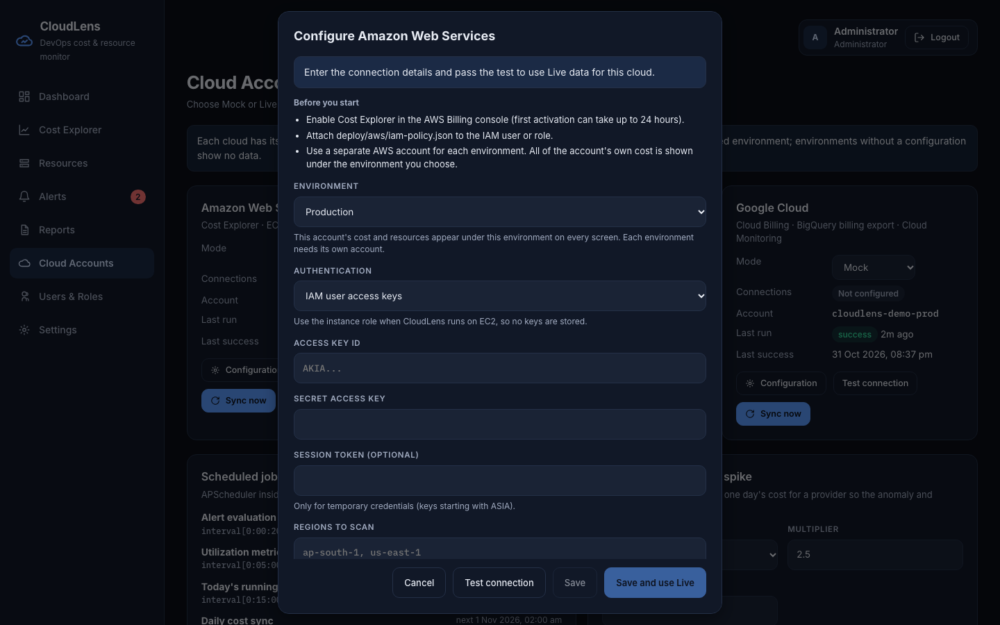
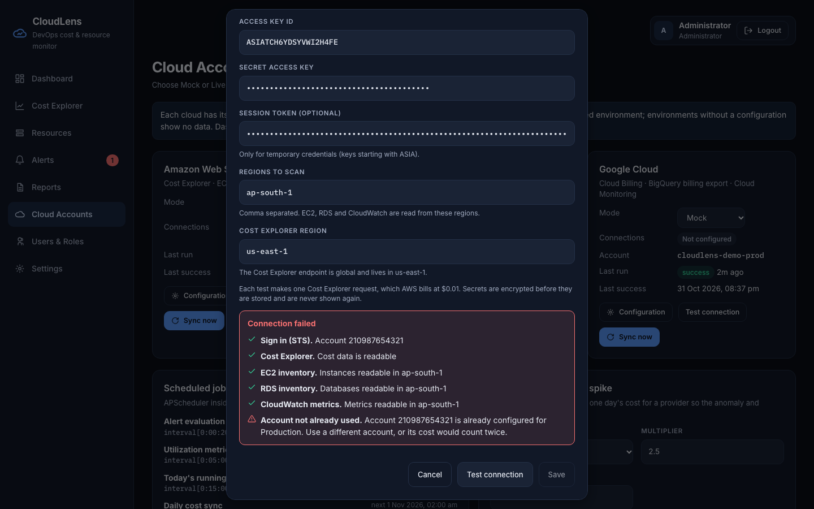

# Screen: Cloud Accounts (admin)

**Route:** `/accounts` · **Files:** `frontend/src/pages/CloudAccountsPage.jsx`, `frontend/src/components/CloudConfigModal.jsx`
**APIs:** `/sync/status`, `/sync/runs` (15 s refresh), `/sync/test/{provider}`, `/sync/run`, `/sync/mock/anomaly`, `/cloud-accounts/{provider}` ([details](../api-reference.md))

## Purpose
Choose where each cloud's data comes from, connect a real account for each environment, and see how syncs are going.
The steps for connecting an account are in [live-cloud-setup.md](../live-cloud-setup.md).

## Sections

| Section | Details |
|---|---|
| Data source notice | Explains the modes, and warns when totals combine real and simulated cost |
| Provider cards (AWS, Azure, GCP) | APIs used; **Mode** dropdown (Mock or Live); connections per environment with validation status, account and any sync error; mock account id while on Mock; last run status and time; last success. Buttons: **Configuration**, **Test connection** (every saved connection, result inline), **Sync now** |
| Scheduled jobs | Every APScheduler job with its trigger and next run time; **Run daily sync now** |
| Demo: simulate a cost spike | Shown while any cloud is on Mock, and lists only those clouds. Provider, multiplier, days ago → **Inject spike** / **Clear spikes**; lists the active spikes |
| Sync history | Started, provider, environment, job, source (Mock or Live), status, cost rows, resources, samples, **API calls**, trigger |

## Configuration form

The API supplies the fields, so each cloud shows its own: prerequisites, the **Environment**, then the inputs and the result of the test.

| Rule | Behavior |
|---|---|
| Choosing **Live** before any environment is validated | Opens this form; the cloud stays on Mock |
| **Environment** | Production, Staging or Development. Each has its own values, and configured ones are marked. The account's data appears under this environment on every screen |
| **Test connection** | Checks required fields and formats first, then calls the cloud and lists each permission as passed or failed |
| Same account as another environment | The test fails and says which environment uses it, so its cost can't count twice |
| **Save**, **Save and use Live** | Off until the values on screen have passed the test; changing a value turns them off again |
| Saved secrets | Never shown again. A blank secret keeps the saved one |
| **Remove** | Forgets that environment's connection, and its figures stop showing. Removing the last one returns the cloud to Mock. Collected data is kept |

The API-call column supports the cost-optimization story (Cost Explorer is billed per request).
