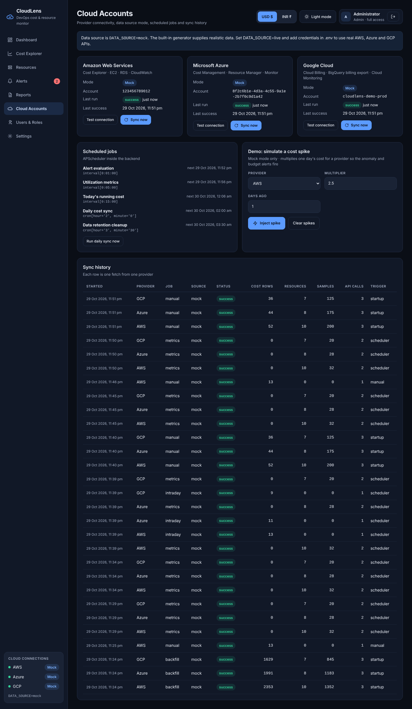

# Screen: Cloud Accounts (admin)

**Route:** `/accounts` · **File:** `frontend/src/pages/CloudAccountsPage.jsx`
**APIs:** `/sync/status`, `/sync/runs` (15 s refresh), `/sync/test/{provider}`, `/sync/run`, `/sync/mock/anomaly`

## Purpose
Sprint 1 connectivity, made visible: which clouds are connected, in which mode, and how syncs are going.

## Sections

| Section | Details |
|---|---|
| Data source notice | Current `DATA_SOURCE` and how to switch |
| Provider cards (AWS, Azure, GCP) | APIs used, mode (Mock / Live credentials set / Live not configured), account id, last run status and time, last success, error; **Test connection** (result inline), **Sync now** |
| Scheduled jobs | Every APScheduler job with its trigger and next run time; **Run daily sync now** |
| Demo: simulate a cost spike | Mock mode only. Provider, multiplier, days ago → **Inject spike** / **Clear spikes**; lists the active spikes |
| Sync history | Started, provider, job, source, status, cost rows, resources, samples, **API calls**, trigger |

The API-call column supports the cost-optimization story (Cost Explorer is billed per request).
