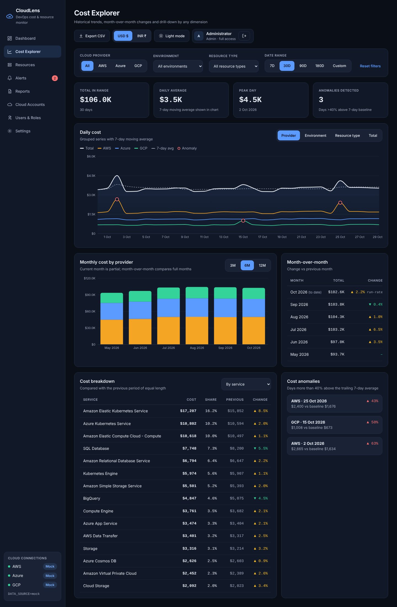

# Screen: Cost Explorer

**Route:** `/costs` · **File:** `frontend/src/pages/CostExplorerPage.jsx`
**APIs:** `/costs/daily`, `/costs/monthly`, `/costs/breakdown`, `/costs/anomalies`, `/costs/export`

## Purpose
Historical analysis (Sprint 4): trends, month-over-month changes and drill-down by any dimension.

## Sections

| Section | Details |
|---|---|
| Filter bar | Adds **180D** and **Custom** (from/to date pickers) |
| Period KPIs | Total in range, daily average, peak day, anomalies detected |
| Daily cost | Group by **Provider / Environment / Resource type / Total**; total line + 7-day moving average (dashed) + anomaly markers |
| Monthly cost by provider | Stacked bars for 3M / 6M / 12M |
| Month-over-month table | Total per month and % change; the current month shows **run-rate** change (daily average vs last month) because it is partial |
| Cost breakdown | By service, provider, environment, resource type, region or account; cost, share, previous period, change %. Top 15 rows |
| Cost anomalies | Days > 40 % above the trailing 7-day average with cost vs baseline |
| Export CSV | Normalized cost lines for the current filters |

## Interactions
- Changing any filter refetches all four datasets.
- Chart tooltips show values in the selected currency.

## Extension notes
- More group-by options: `DIMENSIONS` in `analytics.py` already supports service, region and account; add them
  to `GROUPS` in the page. Service has many keys, so the chart shows the first 8.
- Forecast band: add forecast points to `/costs/daily` and render a dashed area.
