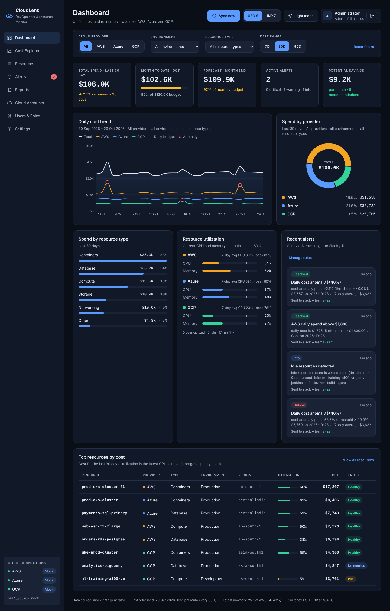

# Screen: Dashboard

**Route:** `/` · **File:** `frontend/src/pages/DashboardPage.jsx` · **API:** `GET /dashboard/overview` (auto-refresh 60 s)

## Purpose
A single real-time view of spend and resource health across AWS, Azure and GCP. This is the screen approved at
the design stage.

## Sections

| # | Section | Content | Source field |
|---|---|---|---|
| 1 | Header actions | **Sync now** (admin) | `POST /sync/run` |
| 2 | Filter bar | provider, environment, type, 7D/30D/90D | query params |
| 3 | KPI cards | Total spend (+ change vs previous period), Month to date (+ budget bar), Forecast (% of budget), Active alerts (by severity), Potential savings | `summary` |
| 4 | Daily cost trend | Total area + one line per provider, dashed **daily budget** line (budget ÷ days in month), red rings on **anomaly** days | `trend`, `anomalies` |
| 5 | Spend by provider | Donut with total in the centre + legend rows (share, amount) | `by_provider` |
| 6 | Spend by resource type | Bar list; the selected type is highlighted | `by_resource_type` |
| 7 | Resource utilization | Current CPU and memory per provider with an 80 % tick, 7-day avg and peak; counts of over-utilized, idle and healthy | `utilization` |
| 8 | Recent alerts | Last 4 notifications with severity, time, message and delivery status | `recent_alerts` |
| 9 | Top resources by cost | 8 rows; click to drill down | `top_resources` |
| 10 | Footer | data source, last refreshed, latest anomaly, exchange rate | — |

## Colour logic
- Period change: an increase is amber (spend up), a decrease green.
- Budget and forecast: green < 80 %, amber 80–99 %, red ≥ 100 %.
- Utilization bars turn red at ≥ 80 %; table status badges: Over-utilized (red), Idle (amber), Healthy (green), No metrics (blue).

## Budget scope rule
If a single provider is selected, that provider's budget is used. If environment or type filters are
active, the budget can't be split meaningfully, so the KPI text says "Budget applies to provider scope"
and the daily-budget line is hidden.

## Role differences
Viewer: no *Sync now* button; the *Manage rules* link becomes *View all*.

## Extension notes
- Add a KPI: add a field in `analytics.summary`, then a `<KpiCard>` in the grid (it auto-wraps).
- The overview endpoint bundles all queries; add new sections there to keep one round trip.
