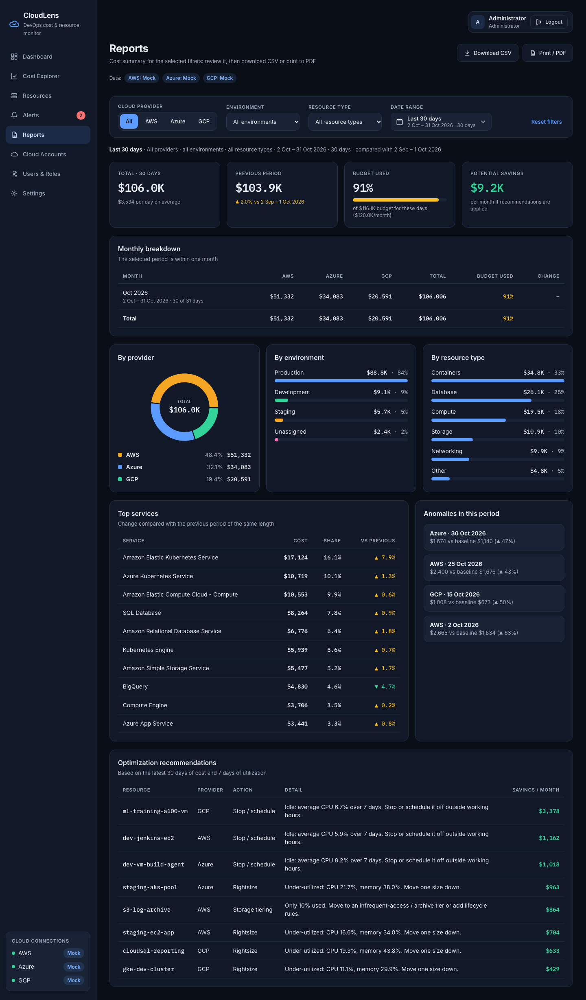

# Screen: Reports

**Route:** `/reports` · **File:** `frontend/src/pages/ReportsPage.jsx` · **APIs:** `/reports/summary`, `/reports/summary.csv`, `/costs/date-bounds`

## Purpose
A cost report for **any cloud, environment, resource type and period** for finance and management reviews, downloadable
as CSV or printable to PDF.

## Header actions
- **Download CSV**: `cloudlens_report_<start>_to_<end>.csv` with the filters used, summary, monthly breakdown, breakdowns, anomalies and recommendations.
- **Print / PDF**: browser print; print styles hide the sidebar, user bar, actions and filters. The period line keeps the filters on paper.

## Filters
The same filter bar as the Dashboard: cloud provider, environment, resource type and date range, with *Reset filters*.
The selection is shared with Dashboard, Cost Explorer and Resources, so the default period is *Last 30 days*.

## Sections

| Section | Details |
|---|---|
| Period line | Preset name, selected filters, exact dates, number of days, and the comparison period |
| KPIs | Total and daily average · previous period of equal length with change % (notes when data does not cover all of it) · budget used, with the monthly budget pro-rated to the days in the range (the cloud's own budget when one cloud is selected, with a note when environment or type narrows the cost further) · potential savings |
| Monthly breakdown | Stacked bar chart (when the range spans 2+ months) and a table: month, cost per provider, total, budget used % for that month, change vs previous month (*run rate* for partial or in-progress months), and a totals row |
| By provider / environment / resource type | Donut and bar lists |
| Top services | Cost, share and change vs the previous period |
| Anomalies | Days > 40 % above the 7-day baseline within the period (first 12 on screen, all in the CSV) |
| Recommendations | Current optimisation actions and savings |

## Extension notes
Scheduled email of this report: render `reports.build_report` server-side (WeasyPrint) and send it from a scheduler job.
