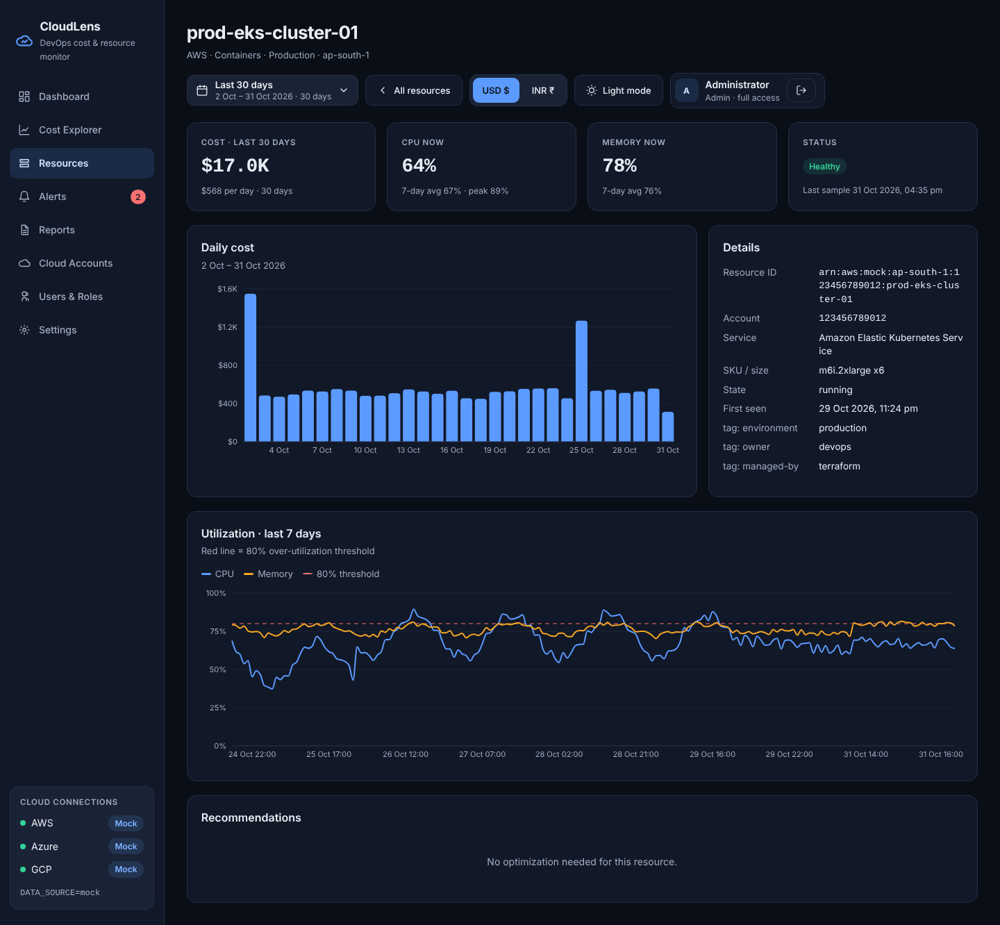

# Screen: Resource Detail (drill-down)

**Route:** `/resources/:id` · **File:** `frontend/src/pages/ResourceDetailPage.jsx` · **API:** `GET /resources/{id}?start=&end=` (60 s refresh)

## Purpose
Answer "why does this resource cost what it does, and is it sized right?"

## Sections
- **Date range** (header): the same shared calendar as the Dashboard; changing it here also changes the other screens.
- **KPIs:** cost for the selected range (and per day), CPU now (7-day average and peak), memory now, status with last sample time.
- **Daily cost:** bar chart for every day of the selected range. Spikes here match anomalies on the dashboard.
- **Details:** resource ID / ARN / URI, account, service, SKU, state, first seen, and all tags.
- **Utilization · 7 days:** CPU, memory and storage lines with the 80 % threshold.
- **Recommendations:** the action and estimated monthly savings for this resource, if any.

Reached by clicking any row in the Dashboard's *Top resources* table or the Resources inventory. *All resources*
returns to the list, keeping the filters.
