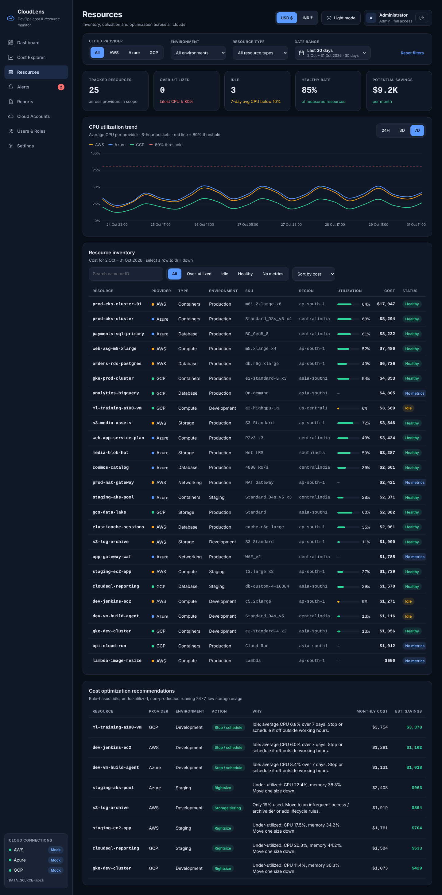

# Screen: Resources

**Route:** `/resources` · **File:** `frontend/src/pages/ResourcesPage.jsx`
**APIs:** `/resources` (60 s refresh), `/resources/utilization`, `/resources/recommendations`

## Purpose
Inventory and utilization across clouds, with over- and under-utilization highlighted and savings proposals.

## Sections

| Section | Details |
|---|---|
| Counts | Tracked resources, Over-utilized (latest CPU ≥ 80 %), Idle (7-day avg < 10 %), Healthy rate, Potential savings |
| CPU utilization trend | Average CPU per provider over 24H / 3D / 7D (1 h or 6 h buckets) with the 80 % threshold line. This window is separate from the date range because hourly utilization samples are kept for 7 days |
| Resource inventory | Cost column covers the selected date range. Search (name or ID, debounced 300 ms), status filter, sort by cost / CPU / name; columns: resource, provider, type, environment, SKU, region, utilization bar, cost, status. **Click a row to drill down.** |
| Recommendations | Resource, provider, environment, action (Stop/schedule, Rightsize, Off-hours schedule, Storage tiering), reason, monthly cost, estimated savings |

## Notes
- Storage rows show *capacity used* instead of CPU.
- Resources without metrics (NAT gateways, BigQuery, Lambda...) show "–" and the *No metrics* status.

## Extension notes
Add columns (for example owner tag) from `analytics.resources` → `ResourceTable` in `components/widgets.jsx`.
