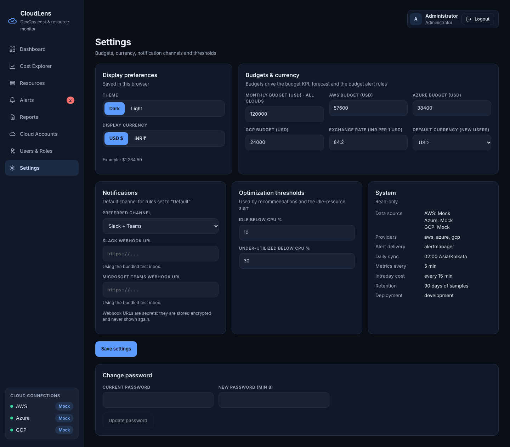
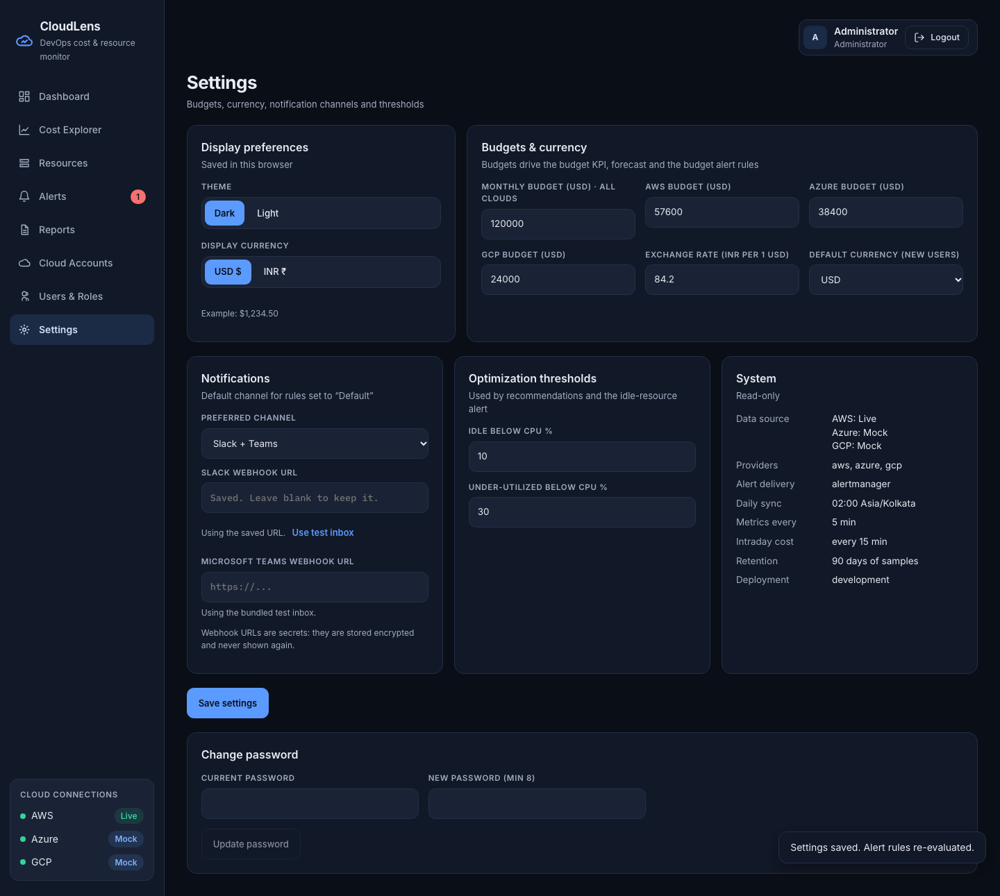

# Screen: Settings

**Route:** `/settings` · **File:** `frontend/src/pages/SettingsPage.jsx` · **APIs:** `GET/PUT /settings`, `/auth/change-password`

## Sections

| Card | Who can edit | Fields |
|---|---|---|
| Display preferences | everyone (stored in the browser) | Theme (dark/light), display currency (USD/INR), example amount. This is the only place to change them |
| Budgets & currency | admin | Monthly budget (all clouds), AWS / Azure / GCP budgets, **exchange rate (INR per USD)**, default currency for new users |
| Notifications | admin | Preferred channel (Slack, Teams, both); shows whether the webhooks are configured or point to the mock receiver |
| Optimization thresholds | admin | Idle below CPU %, under-utilized below CPU % |
| System (read-only) | — | Data source, providers, alert delivery, sync times, intervals, retention, environment |
| Change password | everyone | Current and new password |

For viewers the organisation fields are rendered in a disabled `<fieldset>`.
**Save settings** persists the changes, then re-evaluates alert rules so budget changes take effect at once.

**Notifications** also holds the Slack and Microsoft Teams webhook URLs (admins only). They must start with `https://`, are stored encrypted and are never shown again. Leave one blank to keep it, or click **Use test inbox** to go back to the bundled inbox. Saving takes effect immediately, with no restart.

