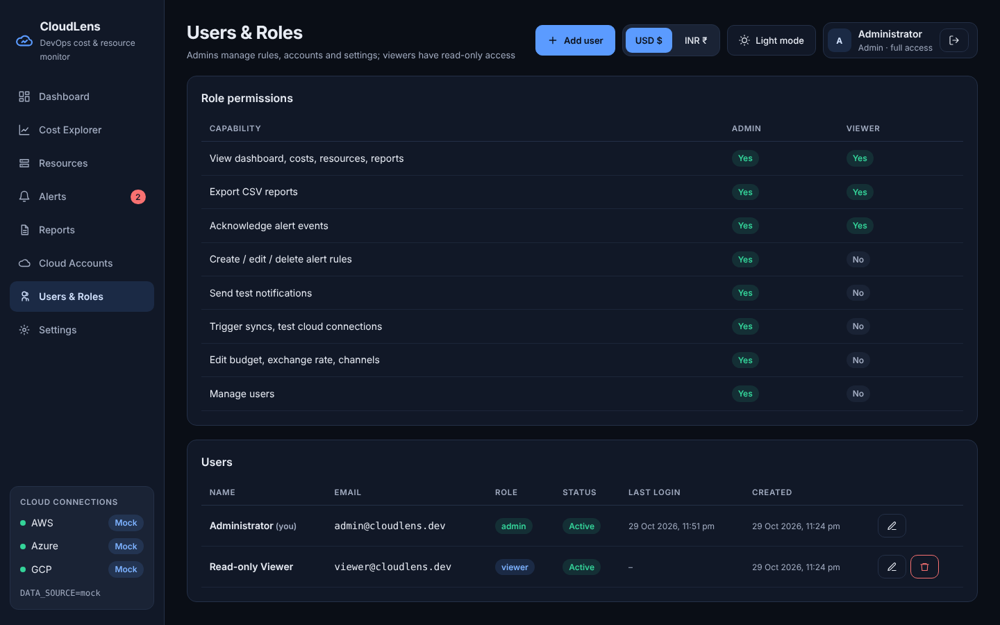

# Screen: Users & Roles (admin)

**Route:** `/users` · **File:** `frontend/src/pages/UsersPage.jsx` · **APIs:** `/users` CRUD

## Sections
- **Role permissions matrix:** what Admin and Viewer can do (mirrors the API enforcement).
- **Users table:** name ("you" marker), email, role badge, active or disabled, last login, created; edit and delete.
- **Add user / Edit user modal:** email (create only), full name, password (min 8; optional when editing),
  role, active (edit only).

## Safeguards
You cannot delete, demote or disable your own account. Duplicate emails are rejected (409).
Delete asks for confirmation.
